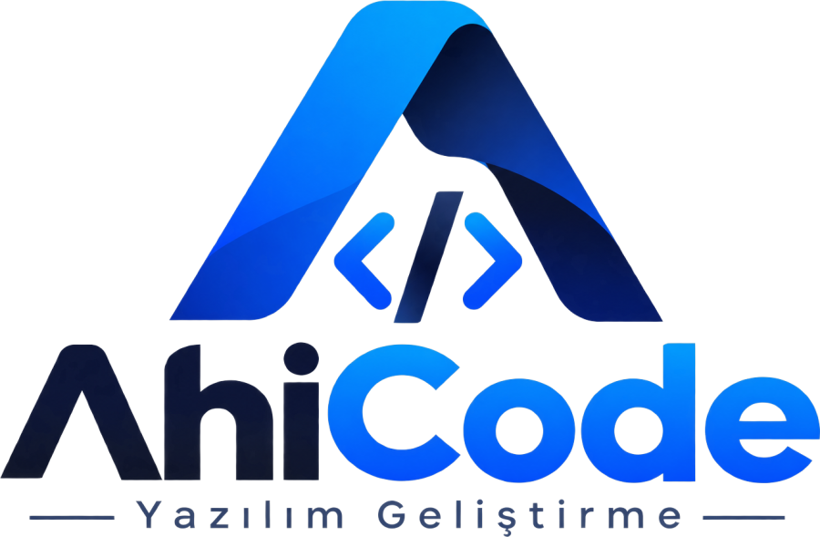

<div align="center">

<picture>
  <source media="(prefers-color-scheme: dark)" srcset="./resources/logo-dark.png" />
  
</picture>

# AhiCode

**Autonomous AI coding agent for VS Code, built with the Ahilik craftsmanship discipline and engineering rigor.**

[🇹🇷 Türkçe](README.tr.md) | **English**

> _"Master your hand, your waist, and your tongue."_ — The Ahilik Craftsmanship Ethos  
> **Hand (Craftsmanship):** Meticulous code writing and architectural analysis · **Waist (Belt of Discipline):** Unbreakable permission guardrails and directory jail · **Tongue (Ethics):** Honest status reporting and hash-chained audit trails.

[](./LICENSE)
[](https://code.visualstudio.com/)
[](https://www.typescriptlang.org/)
[](https://github.com/ysf-bkr/ahi-code/actions/workflows/ci.yml)
[](./docs/DEVELOPMENT.md)

**Developer:** Yusuf BEKAR · **Email:** [ybekar@msn.com](mailto:ybekar@msn.com)

[GitHub Repository](https://github.com/ysf-bkr/ahi-code) · [Issues & Requests](https://github.com/ysf-bkr/ahi-code/issues) · [Developer Guide](./docs/DEVELOPMENT.md)

</div>

> [!IMPORTANT]
> **Runs Locally and Privately by Default**
>
> AhiCode does not depend on any cloud provider. **The default provider is Ollama**: ready to run completely offline on your local machine right after installation without requiring any API keys. EVREN LLM, OpenRouter, and OpenAI-compatible endpoints can be optionally configured.

---

## Key Features

| Feature | Description |
| --- | --- |
| **Autonomous ReAct Loop** | Inspects files, executes terminal commands, runs tests, and autonomously resolves errors until the goal is achieved. |
| **Code Changes & Review** | All edits made in a turn are grouped together; review them in the VS Code Diff view with a single click and roll back when needed. |
| **Guided Workflow Stages** | Controlled engineering through Onboard → Intake → Spec Approval → Module Map + Plan Approval → Implementation → Review → Verification. |
| **Industrial Module Flow** | Before writing code the agent splits the work into layered modules (shared → domain → infrastructure → application → interface), assigns an owning specialist and writes them in dependency order; layering violations and cycles are rejected. |
| **Wide Model Compatibility** | Full support for EVREN LLM (SSYZ), local Ollama, LM Studio, OpenRouter, and all OpenAI API-compatible models. |
| **Secure Credential Storage** | API keys are encrypted inside the operating system's secure keychain (`SecretStorage`) and never exposed in the UI. |
| **Project Memory & Knowledge** | Retains architectural decisions, conventions, and symbols via `.ahi/memory.md` and `.ahi/knowledge/`. |
| **Undo & Checkpoints** | A Git checkpoint is captured at the start of every turn; discard unwanted changes with a single click. |
| **EVREN Quota & Model Bar** | The composer bar shows live EVREN daily token quota (used / limit / remaining) and lets you switch models without leaving the chat. |
| **Background Chats** | Every chat runs in its own agent core: switching chats or starting a new one keeps the previous task (and its subagents) running. Shared services keep a second chat cheap. |
| **Bilingual Documentation & Turkish UI** | Bilingual English/Turkish project docs; every error message, notification, and plan step in the interface is native Turkish. |

---

## Quick Start

### 1. Installation

> [!NOTE]
> The extension is not yet published to the VS Code Marketplace. Until the
> first release, build the VSIX locally with the steps below.

Build and install from the local VSIX package (`out/ahi-code-0.0.2.vsix`):

```bash
# To build, package, and install automatically:
npm run install:ext

# Or install the generated VSIX package directly:
code --install-extension out/ahi-code-0.0.2.vsix --force
```

### 2. Choose Your Model Provider

Click the **AhiCode** icon in the VS Code secondary sidebar or open the command palette (`Ctrl+Shift+P` / `Cmd+Shift+P`) and run `AhiCode: Sohbeti Aç` (Open Chat).

- **Local Ollama (Recommended local option):** If Ollama is running, start chatting immediately without additional configuration.
- **EVREN LLM:** Select EVREN in Settings and save your API key.
- **OpenRouter / OpenAI-Compatible:** Choose your provider and save your credentials.

### 3. Start a Task

Type your request in the AhiCode composer:
- _"Find and fix compilation and type errors in the project."_
- _"Write and run unit tests for the authentication service."_
- _"Review the codebase for security vulnerabilities and performance bottlenecks."_

---

## Operating Modes: Code and Plan

AhiCode provides two primary modes of operation:

1. **Code Mode (`code`):** Has authority to create and edit files and execute terminal commands. Actively builds and refactors your project.
2. **Plan Mode (`plan`):** File writing and command execution tools are locked down. Performs read-only exploration and architectural analysis to generate clear implementation blueprints.

---

## Interactive Review Experience

AhiCode incorporates best-in-class coding agent patterns:
- **Turn Changes Panel:** All created or modified files in a turn are consolidated into a review card.
- **One-Click Diff:** Click **İncele (Diff)** to inspect color-coded side-by-side diffs.
- **Granular Revert:** Discard unwanted file changes with the **Geri Al** (Undo) action.
- **Live Plan Progress:** Track stage completions in real-time (`%25`, `%50`, `%100`).

---

## Core Settings

Configure the following settings in VS Code Settings (`settings.json`) or inside the AhiCode Settings view:

| Setting | Default | Description |
| --- | --- | --- |
| `ahiCode.selectedProvider` | `ollama` | Model provider (`ollama`, `evren`, `openrouter`, `openai-compatible`) |
| `ahiCode.selectedModel` | `llama3.1` | Model identifier to use |
| `ahiCode.autonomy` | `manual` | Autonomy level (`manual`, `guided`, `auto`); also switchable from the chat composer |
| `ahiCode.agentModels` | `{}` | Per-role subagent models (role → model id). Empty roles fall back to the provider preset (EVREN: manager/architect → GLM-5.3, explorer → MiMo-V2.6-Pro) or the selected model |
| `ahiCode.embeddingBaseUrl` | `""` | OpenAI-compatible embedding endpoint (e.g. EVREN `/v1`). Empty uses Ollama `/api/embed` |

---

## Architecture & Developer Guide

Internal architecture, module boundaries, testing instructions, and contribution guides are documented separately:

- **[Developer Guide (docs/DEVELOPMENT.md)](./docs/DEVELOPMENT.md)** · **[🇹🇷 Türkçe](./docs/DEVELOPMENT.tr.md):** Build from source, test suites, design tokens, and MCP integration.
- **[Architecture Guide (docs/ARCHITECTURE.md)](./docs/ARCHITECTURE.md)** · **[🇹🇷 Türkçe](./docs/ARCHITECTURE.tr.md):** ReAct loop, tool pipeline, audit ledger, and language services.
- **[Privacy Notice (docs/PRIVACY.md)](./docs/PRIVACY.md)** · **[🇹🇷 Türkçe](./docs/PRIVACY.tr.md):** Data privacy, local-first principles, and telemetry policies.

---

## Known Limitations

- **Command undo needs a clean Git tree:** `execute_command` takes a Git checkpoint and can be reverted, but only when the repository has a `HEAD` and the working tree was clean before the command. Outside a Git repository, command side effects are not undoable; use Git yourself for those.
- **Plan mode is a tool lock, not a sandbox:** plan mode removes write and command tools from the schema, but it does not replace OS-level isolation. Use a Dev Container for untrusted repositories.
- **Not yet on the Marketplace:** installation currently requires a locally built VSIX.

---

## License & Support

This project is open-source under the [MIT License](./LICENSE).

Contributions are welcome: see [CONTRIBUTING.md](./CONTRIBUTING.md) and the
[Code of Conduct](./CODE_OF_CONDUCT.md). Report security issues privately per
[SECURITY.md](./SECURITY.md).

For questions, bug reports, and feature requests, visit the [GitHub Issues](https://github.com/ysf-bkr/ahi-code/issues) page or reach out directly at [ybekar@msn.com](mailto:ybekar@msn.com).
